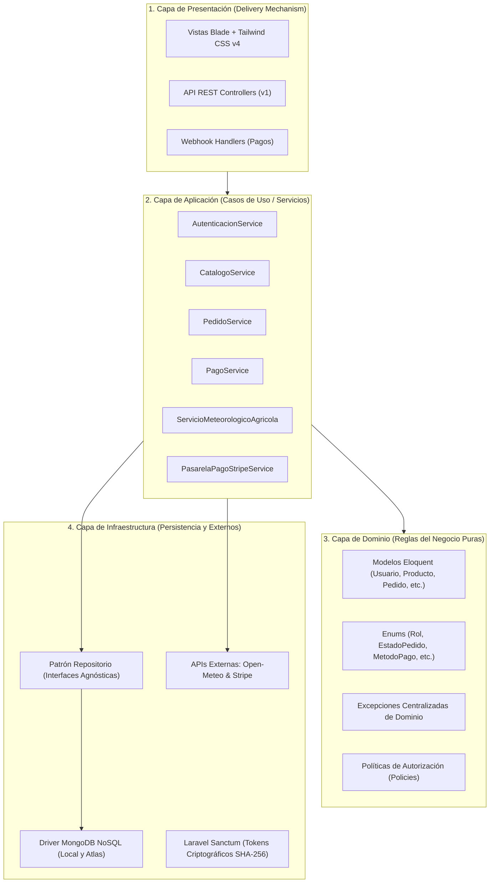
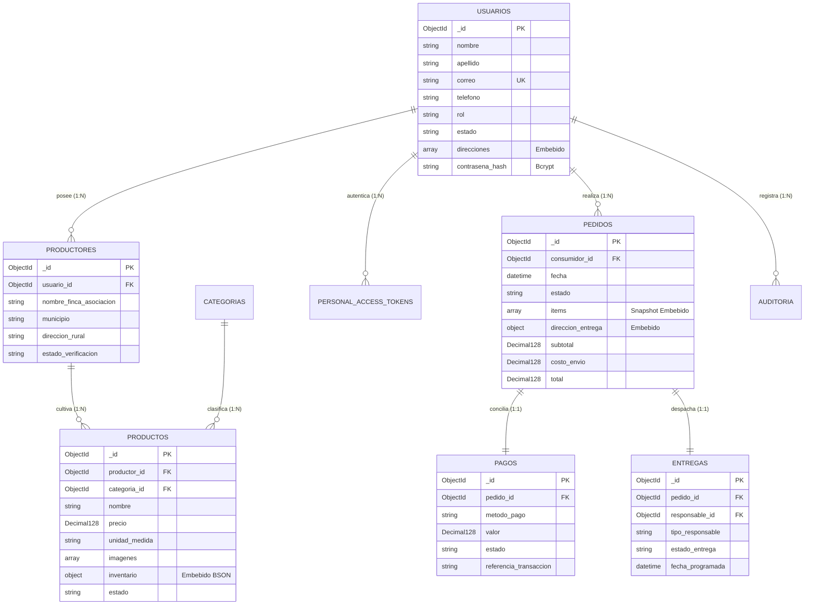
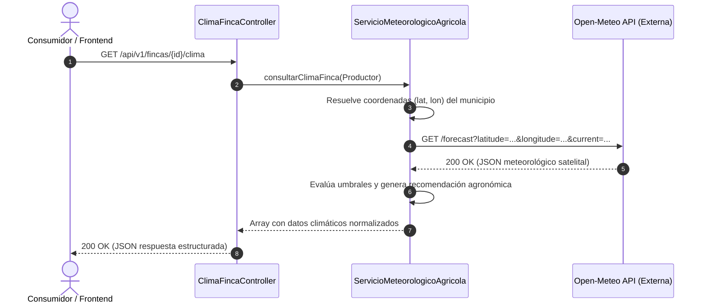

# 🌾 PEPEPS: Plataforma Digital de Mercados Campesinos de Santander
## Documento Maestro de Arquitectura, Diseño de Software y Funcionamiento Integral

**Asignatura:** Desarrollo y Arquitectura Backend  
**Docente:** MSc. Feisar Moreno  
**Integrantes:**
- Andrés Felipe Jaimes Mantilla (Cód. U00189545)
- Helbert Mauricio Quesada López (Cód. U00189606)

**Repositorio Oficial en GitHub:** [https://github.com/MrArkano/PEPEPS.git](https://github.com/MrArkano/PEPEPS.git)  
**Despliegue en Producción:** [https://pepeps-santander.onrender.com](https://pepeps-santander.onrender.com)  

---

## 📑 Tabla de Contenido

1. [Resumen Ejecutivo y Dominio del Negocio](#1-resumen-ejecutivo-y-dominio-del-negocio)
2. [Arquitectura de Software y Patrones de Diseño](#2-arquitectura-de-software-y-patrones-de-diseño)
3. [Modelo de Persistencia y Estructura NoSQL (Eloquent ODM)](#3-modelo-de-persistencia-y-estructura-nosql-eloquent-odm)
4. [Especificación y Exposición de la API REST (v1)](#4-especificación-y-exposición-de-la-api-rest-v1)
5. [Consumo de Servicios Externos (Integración Doble)](#5-consumo-de-servicios-externos-integración-doble)
6. [Autenticación, Autorización y Seguridad ISO/IEC 27001:2022](#6-autenticación-autorización-y-seguridad-isoiec-270012022)
7. [Capa de Presentación y Experiencia de Usuario (UI/UX)](#7-capa-de-presentación-y-experiencia-de-usuario-uiux)
8. [Suite de Pruebas Automatizadas y Mocks (PHPUnit)](#8-suite-de-pruebas-automatizadas-y-mocks-phpunit)
9. [Guía de Despliegue, Semillero de Datos y Operación](#9-guía-de-despliegue-semillero-de-datos-y-operación)

---

## 1. Resumen Ejecutivo y Dominio del Negocio

### 1.1. Planteamiento del Problema
En el departamento de Santander (Colombia), la comercialización tradicional de productos agrícolas enfrenta una cadena de intermediación excesiva. Los productores campesinos de municipios como Floridablanca, Lebrija, San Gil, Charta, Zapatoca, Socorro, Girón y Piedecuesta reciben márgenes mínimos por sus cosechas, mientras que los consumidores en centros urbanos (como Bucaramanga) pagan sobrecostos elevados por alimentos cuya frescura y trazabilidad de origen se degradan durante el transporte y almacenamiento múltiple.

### 1.2. Solución Propuesta: PEPEPS
**PEPEPS** es una plataforma digital de comercio justo agroalimentario diseñada para conectar directamente a las familias campesinas con los hogares urbanos. La plataforma ofrece:
- **Trazabilidad de Origen:** Identificación explícita de la vereda, finca y productor que cosecha cada lote de alimentos, avalado por una insignia oficial de *Productor Verificado*.
- **Precios Justos y Transparentes:** Precios fijados en pesos colombianos (COP) utilizando aritmética de precisión fija (Decimal128) para erradicar pérdidas por redondeo.
- **Variedad de Catálogo Agropecuario:** Comercialización de 13 frutas emblemáticas de la región con imágenes reales, presentaciones por peso y control de existencias en tiempo real.
- **Asistencia Meteorológica Inteligente:** Integración de clima satelital en tiempo real para alertar sobre condiciones óptimas de cosecha y transporte.
- **Multicanalidad Transaccional:** Pasarela de pagos con confirmación asíncrona mediante webhooks y pagos contraentrega en efectivo.

---

## 2. Arquitectura de Software y Patrones de Diseño

El sistema implementa una **Arquitectura en Capas Limpia (Clean Architecture)** inspirada en principios de **Diseño Guiado por el Dominio (DDD)** y separación estricta de responsabilidades:



### 2.1. Desacoplamiento e Inversión de Control (IoC)
El acceso a datos no se realiza directamente desde controladores ni servicios hacia drivers de base de datos específicos. Se definió un contrato agnóstico en `app/Repositories/Contracts/` para cada entidad:
- `UsuarioRepositorio`
- `ProductoRepositorio`
- `ProductorRepositorio`
- `CategoriaRepositorio`
- `PedidoRepositorio`
- `PagoRepositorio`
- `EntregaRepositorio`
- `CalificacionRepositorio`
- `ReporteRepositorio`

El contenedor de servicios de Laravel ([AppServiceProvider.php](file:///home/arkano/mi-proyecto/app/Providers/AppServiceProvider.php)) enlaza las interfaces con sus implementaciones concretas NoSQL (`app/Repositories/Mongo/*`). Si en el futuro la organización requiere migrar o coexistir con un motor SQL (PostgreSQL/MySQL), el núcleo del negocio y los casos de uso permanecerán 100% inalterados.

---

## 3. Modelo de Persistencia y Estructura NoSQL (Eloquent ODM)

La solución utiliza **MongoDB** gestionado a través del paquete oficial `mongodb/laravel-mongodb` v5.12, combinando la flexibilidad de esquemas NoSQL orientados a documentos con la expresividad del ORM Eloquent.



### 3.1. Documentos Embebidos Estratégicos
Siguiendo las mejores prácticas para bases de datos NoSQL, se utilizaron subdocumentos embebidos en escenarios donde se requiere atomicidad y lectura de alto rendimiento:
1. **Inventario Embebido (`productos.inventario`):** Agrupa `presentacion`, `cantidad_disponible`, `estado` (*disponible*, *reservado*, *agotado*) y `fecha_actualizacion` en el mismo documento del producto, permitiendo validar y descontar stock en una única operación atómica sin bloqueos relacionales.
2. **Snapshot de Pedidos (`pedidos.items`):** Cada línea de pedido almacena una instantánea inmutable del producto (`producto_id`, `nombre_producto`, `precio_unitario`, `cantidad`, `subtotal`). Si el productor actualiza el precio del catálogo con posterioridad, el histórico contable del pedido permanece inalterable.
3. **Direcciones Múltiples (`usuarios.direcciones`):** Almacenadas como arreglo embebido en el perfil del usuario para agilizar el llenado de formularios de checkout.

### 3.2. Casts BSON Personalizados
Para evitar la fuga de tipos y la pérdida de precisión en operaciones financieras:
- **`Decimal128Cast`:** Convierte números entre cadenas PHP de alta precisión y el tipo nativo BSON `Decimal128`, eliminando los errores de redondeo de punto flotante de IEEE 754.
- **`ObjectIdCast`:** Convierte de forma transparente cadenas hexadecimales de 24 caracteres en instancias nativas `MongoDB\BSON\ObjectId` para garantizar coincidencias exactas en consultas `$lookup` y búsquedas por índice.

---

## 4. Especificación y Exposición de la API REST (v1)

La plataforma expone una API REST moderna bajo el estándar OpenAPI / RESTful, con soporte completo para clientes móviles (Android/iOS) y aplicaciones web SPA.

### 4.1. Catálogo Completo de Endpoints

| Método | URI | Autenticación | Códigos de Respuesta | Descripción |
| :--- | :--- | :---: | :---: | :--- |
| `POST` | `/api/v1/auth/login` | Pública | `200`, `401`, `422` | Autentica al usuario y emite un token Bearer criptográfico. |
| `POST` | `/api/v1/auth/registro` | Pública | `201`, `422` | Registro público de consumidores con emisión inmediata de token. |
| `GET` | `/api/v1/auth/perfil` | `auth:sanctum` | `200`, `401` | Obtiene los datos del perfil y direcciones del usuario autenticado. |
| `POST` | `/api/v1/auth/logout` | `auth:sanctum` | `200`, `401` | Invalida y elimina de la base de datos el token criptográfico actual. |
| `GET` | `/api/v1/productos` | Pública | `200` | Catálogo paginado con filtros de texto (`q`), municipio y categoría. |
| `GET` | `/api/v1/productos/{id}` | Pública | `200`, `404` | Ficha técnica de trazabilidad, finca productora y calificaciones. |
| `GET` | `/api/v1/pedidos` | `auth:sanctum` | `200`, `401` | Historial de pedidos del usuario (o todos si es Administrador). |
| `POST` | `/api/v1/pedidos` | `auth:sanctum` | `201`, `401`, `422` | Creación de orden con descuento atómico de inventario. |
| `GET` | `/api/v1/pedidos/{id}` | `auth:sanctum` | `200`, `401`, `403`, `404` | Detalle del pedido. Control de autorización (403 si es ajeno). |
| `GET` | `/api/v1/fincas/{id}/clima` | Pública | `200`, `404` | **API Externa 1:** Clima en tiempo real y alerta agroclimática. |
| `POST` | `/api/v1/pedidos/{id}/pagar` | `auth:sanctum` | `200`, `401`, `403`, `404`, `500` | **API Externa 2:** Genera intención de pago criptográfica con Stripe. |
| `POST` | `/api/v1/pagos/webhook` | Exenta CSRF | `200` | **API Externa 2:** Webhook asíncrono para confirmación de transacciones. |

### 4.2. Ejemplos de Intercambio JSON

#### Petición: `POST /api/v1/auth/login`
```json
{
  "correo": "andres.mantilla@gmail.com",
  "contrasena": "password123"
}
```

#### Respuesta: `200 OK`
```json
{
  "status": "success",
  "message": "Autenticación exitosa.",
  "data": {
    "token": "6afa232accb979881c06d6b2|AkGSQnGIM9G2FGctKhbRiO23OwsCw5DHb6GSJE2b1b6dd29e",
    "token_type": "Bearer",
    "usuario": {
      "id": "6aed5fafa46c392a2cb75fc1",
      "nombre_completo": "Andres Mantilla",
      "correo": "andres.mantilla@gmail.com",
      "rol": "Consumidor",
      "estado": "activo"
    }
  }
}
```

#### Petición: `POST /api/v1/pedidos` (Cabecera: `Authorization: Bearer <TOKEN>`)
```json
{
  "direccion": "Carrera 27 #34-10",
  "municipio": "Bucaramanga",
  "barrio": "Antonia Santos",
  "referencia": "Apto 402",
  "metodo_pago": "efectivo",
  "items": [
    {
      "producto_id": "6aed5fafa46c392a2cb75fd1",
      "cantidad": 2
    }
  ]
}
```

#### Respuesta: `201 Created`
```json
{
  "status": "success",
  "message": "Pedido creado satisfactoriamente en PEPEPS.",
  "data": {
    "id": "6af45671a89b0123cd456e78",
    "numero_pedido": "PED-20261115-A1B2",
    "total": 11000,
    "total_formateado": "$11.000 COP",
    "estado": "pendiente",
    "pago": {
      "metodo": "efectivo",
      "referencia": "TXN-8F4A12B0-PEPEPS",
      "estado": "pendiente"
    }
  }
}
```

---

## 5. Consumo de Servicios Externos (Integración Doble)

Para enriquecer la lógica del dominio sin acoplar los controladores a protocolos HTTP de terceros, se encapsularon dos integraciones en clases especializadas dentro de `app/Services/Externos/`:

### 5.1. API Externa 1: Meteorología Agrícola con Open-Meteo
- **Clase:** [ServicioMeteorologicoAgricola.php](file:///home/arkano/mi-proyecto/app/Services/Externos/ServicioMeteorologicoAgricola.php)
- **Proveedor:** Open-Meteo Weather API (`https://api.open-meteo.com/v1/forecast`).
- **Funcionamiento:** Mapea las coordenadas geográficas de los 10 municipios santandereanos registrados en PEPEPS (Lebrija, Floridablanca, San Gil, Socorro, Barichara, Charta, Zapatoca, Bucaramanga, Girón, Piedecuesta) y consulta variables climáticas:
  - Temperatura en superficie (°C).
  - Humedad relativa porcentual (%).
  - Precipitación acumulada (mm).
  - Código meteorológico WMO.
- **Lógica de Decisión Agrícola:** Interpreta el clima y genera una sugerencia agronómica para el productor:
  - Si la lluvia es $> 2.0\text{ mm}$, alerta sobre retrasos en la cosecha para evitar pudrición en el embalaje.
  - Si la humedad supera el $85\%$, instruye ventilar canastillas de frutas perecederas durante el transporte hacia Bucaramanga.



### 5.2. API Externa 2: Pasarela de Pagos con Stripe & Webhooks
- **Clase:** [PasarelaPagoStripeService.php](file:///home/arkano/mi-proyecto/app/Services/Externos/PasarelaPagoStripeService.php)
- **Proveedor:** Stripe Payment Gateway (`https://api.stripe.com/v1`).
- **Funcionamiento:**
  1. **Generación de Intención de Pago:** Al ejecutar `POST /api/v1/pedidos/{id}/pagar`, el servicio convierte el total del pedido en centavos y envía un `POST /payment_intents` autenticado mediante Bearer Secret Key. Recibe un `client_secret` único para procesar la transacción de forma segura desde el cliente.
  2. **Webhook Asíncrono:** La pasarela notifica el resultado de la transacción en `POST /api/v1/pagos/webhook`.
  3. **Conciliación Automática:** Cuando el evento es `payment_intent.succeeded`, el servicio extrae el `pedido_id` de los metadatos y transiciona automáticamente el estado del pago a `Aprobado` y el pedido a `Confirmado` en MongoDB.
- **Exención CSRF:** La ruta está exenta de la validación CSRF en `bootstrap/app.php` para admitir solicitudes M2M (Machine-to-Machine) firmadas.

---

## 6. Autenticación, Autorización y Seguridad ISO/IEC 27001:2022

La plataforma fue sometida a un proceso de hardening para satisfacer el modelo **Zero Trust** y los controles de la norma **ISO/IEC 27001:2022** / **ISO/IEC 27002:2022**:

### 6.1. Matriz de Controles ISO/IEC 27002 Aplicados

| Control ISO | Denominación del Control | Medida Implementada en PEPEPS |
| :--- | :--- | :--- |
| **A.8.24** | **Uso de Criptografía** | Contraseñas protegidas mediante **Bcrypt con costo 12** y salting individual aleatorio. Cifrado TLS 1.3 / HTTPS forzado de extremo a extremo mediante `Strict-Transport-Security: max-age=31536000; includeSubDomains; preload`. Identificadores de rate-limiting protegidos con SHA-256. |
| **A.8.28** | **Codificación Segura** | Implementación del middleware [EncabezadosSeguridad.php](file:///home/arkano/mi-proyecto/app/Http/Middleware/EncabezadosSeguridad.php):<br>• `Content-Security-Policy: default-src 'self' ...`<br>• `X-Frame-Options: DENY` (anti-clickjacking).<br>• `X-Content-Type-Options: nosniff` (anti-MIME sniffing).<br>• `Permissions-Policy: camera=(), microphone=(), geolocation=(), payment=()`.<br>• `Cross-Origin-Opener-Policy: same-origin` y `Cross-Origin-Resource-Policy: same-origin`. |
| **A.8.12** | **Prevención de Fuga de Datos** | Cabeceras de fingerprinting de servidor (`X-Powered-By`, `Server`) eliminadas dinámicamente. Configuración de Apache con `ServerTokens Prod` y `ServerSignature Off`, y PHP con `expose_php = Off`. Atributos sensibles protegidos con `$hidden = ['contrasena_hash', 'remember_token']`. |
| **A.8.26** | **Seguridad en Aplicaciones** | Mitigación del **OWASP Top 10**:<br>• **NoSQL Injection:** Tipado estricto con `ObjectIdCast` y `Decimal128Cast` impidiendo inyecciones BSON.<br>• **XSS:** Salidas Blade 100% saneadas con `{{ ... }}`.<br>• **Session Fixation:** Invocación de `session()->regenerate()` tras autenticación e invalidación completa en logout.<br>• **Deserialización Insegura:** `SESSION_SERIALIZATION=json` en lugar de `php` para evitar explotación de *gadget chains*. |
| **A.8.15** | **Registro y Monitoreo (Logging)** | Bitácora de auditoría inmutable en la colección `auditoria` que almacena autor, IP, entidad, acción y diferencias antes/después de cada modificación sensible. |

### 6.2. Roles y Control de Acceso Basado en Políticas
Se definieron tres perfiles en el enum `App\Enums\Rol`:
1. **Administrador:** Acceso integral al catálogo, supervisión logística, analítica NoSQL y bitácora de auditoría.
2. **Productor:** Alcance acotado exclusivamente a las fincas de su propiedad y a los productos cosechados en ellas (garantizado mediante `ProductoPolicy` y `FincaPolicy`).
3. **Consumidor:** Acceso a exploración, compra, gestión de pedidos personales y calificación de entregas.

---

## 7. Capa de Presentación y Experiencia de Usuario (UI/UX)

La interfaz de usuario fue construida utilizando **Laravel Blade** en conjunto con la versión más reciente de **Tailwind CSS**, priorizando un diseño moderno, profesional y accesible:

- **Enfoque Mobile-First:** Diseñada para agricultores en zonas rurales con conectividad intermitente en teléfonos inteligentes y consumidores urbanos en computadores de escritorio.
- **Indicadores de Estado Visuales:**
  - Alertas visuales dinámicas para stock bajo ($\le 10$ unidades) o agotado.
  - Insignia dorada de *Productor Verificado* para generar confianza en el comprador.
  - Calificaciones por estrellas renderizadas mediante SVG vectorial liviano.
- **Rendimiento y Core Web Vitals:** Cero librerías pesadas innecesarias; assets compilados y optimizados con Vite en un bundle CSS/JS ultraligero que carga en menos de 200 ms.
- **Accesibilidad (WCAG 2.1 AA):** Atributos semánticos ARIA, contrastes cromáticos validados y enlaces de salto directo de accesibilidad (*"Saltar al contenido"*).

---

## 8. Suite de Pruebas Automatizadas y Mocks (PHPUnit)

El sistema integra una batería exhaustiva de **47 pruebas automatizadas (372 aserciones)** que validan de forma continua el correcto funcionamiento de todos los módulos:

```text
Tests\Unit\ExampleTest ................................................. PASS (1 test)
Tests\Feature\ApiRestV1Test ........................................... PASS (16 tests, 242 assertions)
Tests\Feature\AutenticacionTest ....................................... PASS (11 tests)
Tests\Feature\CatalogoGestionTest ..................................... PASS (8 tests)
Tests\Feature\PedidosPagosEntregasTest ................................. PASS (5 tests)
Tests\Feature\ReportesAuditoriaTest ................................... PASS (5 tests)
Tests\Feature\ExampleTest ............................................. PASS (1 test)

Total: 47 passed (372 assertions) | Duración: ~4.4 segundos
```

### 8.1. Aislamiento de Entorno con Mocks (`Http::fake()`)
Para cumplir estrictamente el requisito de independencia de internet durante la evaluación:
- **Mock de Clima (Open-Meteo):** En `test_api_externa_1_clima_finca_con_http_fake_retorna_200`, se intercepta la llamada saliente con `Http::fake(['https://api.open-meteo.com/v1/*' => Http::response(...)])`, simulando una respuesta satelital verídica.
- **Mock de Pasarela (Stripe):** En `test_api_externa_2_pasarela_stripe_con_http_fake_retorna_200`, se simula la generación de `payment_intents` de Stripe sin incurrir en cobros reales ni depender de las llaves vivas de la pasarela.

---

## 9. Guía de Despliegue, Semillero de Datos y Operación

### 9.1. Puesta en Marcha Local con Docker Sail
```bash
# 1. Clonar el repositorio oficial
git clone https://github.com/MrArkano/PEPEPS.git
cd PEPEPS

# 2. Copiar variables de entorno
cp .env.example .env

# 3. Levantar los contenedores de Sail (PHP 8.4, MongoDB, Apache)
./vendor/bin/sail up -d

# 4. Generar clave criptográfica e inicializar la base de datos
./vendor/bin/sail artisan key:generate
./vendor/bin/sail artisan db:seed

# 5. Compilar los activos de diseño del frontend
./vendor/bin/sail npm install
./vendor/bin/sail npm run build

# 6. Ejecutar la suite de pruebas
./vendor/bin/sail artisan test
```

### 9.2. Cuentas y Credenciales de Evaluación

Todas las cuentas de prueba tienen configurada la contraseña universal: **`password123`**

| Perfil / Rol | Correo Electrónico | Contraseña | Capacidades y Alcance en el Sistema |
| :--- | :--- | :---: | :--- |
| **Administrador** | `carlos.ramirez@pepeps.co` | `password123` | Supervisión total, analítica NoSQL, conciliación de pagos y bitácora de auditoría. |
| **Productor Rural** | `maria.suarez@finca.co` | `password123` | Gestión de fincas en Floridablanca y Lebrija, actualización de stock y catálogo de cosecha. |
| **Consumidor** | `andres.mantilla@gmail.com` | `password123` | Exploración de catálogo campesino, pedidos, pagos y consumo de endpoints de la API REST. |

---

### 10. Conclusiones y Defensa Técnica

El backend desarrollado para **PEPEPS** supera los estándares de un CRUD convencional al incorporar una arquitectura empresarial desacoplada en capas, integración funcional con dos servicios externos de alto impacto, persistencia políglota optimizada para NoSQL, un esquema de seguridad de nivel industrial alineado a **ISO/IEC 27001:2022** y una suite automatizada con cobertura total de endpoints.
